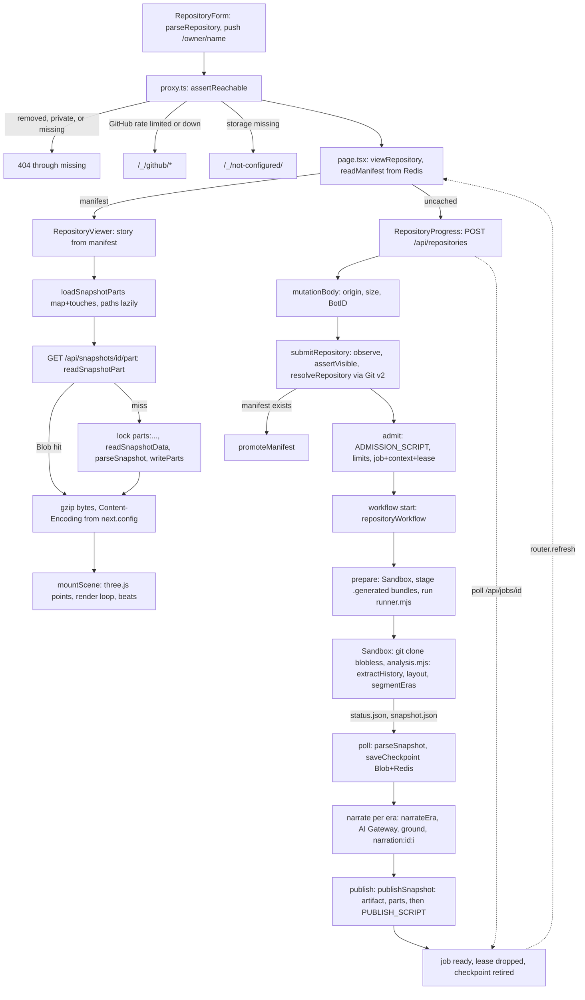

# How Lore works

You give Lore a public GitHub repository. It comes back as a page you can play.

## Overview

The app is Next.js 16, App Router, on Vercel. The server resolves the default branch and HEAD over
the Git smart-HTTP protocol. Admission checks in Redis decide whether the work starts. A Vercel
Workflow then starts a Vercel Sandbox, which clones the repository without blobs and runs a bundled
analysis program. That program reads the first-parent history into per-file tracks (birth, death,
renames, touches), lays the files out in 3D, and cuts the history into chapters. The code calls a
chapter an era. Each era gets factual captions and a fact sheet of evidence. Back in the workflow,
one step per chapter asks a model on AI Gateway to pick two to four landmark commits from that
sheet, and a headline from those commits. A validator rejects any pick that isn't in the sheet. The
snapshot is published as gzip JSON in private Blob, and it stays immutable. A manifest goes into
Redis last, in one atomic Lua script.

Reading stays separate from writing. The repository page renders the chapters from the manifest in
Redis. It doesn't load the artifact to do that. If the description is empty, `withDescription`
(`src/server/catalog.ts:139-152`) fills it from Redis or GitHub. The browser then streams three
parts derived from the JSON artifact and plays a 90-second tour in a three.js point cloud. `map` and
`touches` are binary. `paths` is JSON. What if a part isn't there yet? That happens when the
snapshot predates parts, or when the part format changed. The first reader derives it from the JSON
and stores it under a Redis lock (convert on read). An operator CLI (`scripts/precompute.ts`) runs
the same analysis locally for the curated gallery and publishes through the same storage functions.
Every response carries frame protection and the other security headers set in `next.config.ts:7-18`.
A mutating route accepts a request only when BotID reports a browser (`src/server/http.ts:41-43`).

## Key concepts

The names below are the ones the code uses. The UI says chapter where the code says era.

| Term                    | Meaning                                                                                                                                                                                                                                                                                                                                                                      | Where                                                                          |
| ----------------------- | ---------------------------------------------------------------------------------------------------------------------------------------------------------------------------------------------------------------------------------------------------------------------------------------------------------------------------------------------------------------------------- | ------------------------------------------------------------------------------ |
| Slug                    | `owner/name`. `parseRepository` lowercases it.                                                                                                                                                                                                                                                                                                                               | `src/lib/repository.ts:8-34`, `src/lib/schema.ts:6-8`                          |
| Snapshot                | The immutable analysis of one repository at one head with one layout: repository, coverage, authors, eras, directories, files (tracks) and commits.                                                                                                                                                                                                                          | `snapshotSchema`, `src/lib/schema.ts:208-211`                                  |
| Snapshot ID             | The first 24 hex characters of `sha256("{PIPELINE_VERSION}:{slug lowercased}:{head}:{layout}")`. The job ID and checkpoint ID are the same value.                                                                                                                                                                                                                            | `src/lib/identity.ts:6-14`                                                     |
| Pipeline version        | `PIPELINE_VERSION = 'lore-4'`. It is part of every snapshot ID. A stored snapshot whose version differs is treated as legacy by the parser.                                                                                                                                                                                                                                  | `src/lib/schema.ts:4`, `src/lib/snapshot.ts:19`                                |
| Schema version          | `schemaVersion: z.literal(1)`. The parser accepts only this value for stored snapshots.                                                                                                                                                                                                                                                                                      | `src/lib/schema.ts:194`                                                        |
| Artifact                | The gzip JSON of a whole snapshot in Blob, named by its SHA-256.                                                                                                                                                                                                                                                                                                             | `artifactPath`, `src/server/storage.ts:299-306`                                |
| Manifest                | The snapshot without files and commits, plus `artifact {pathname, sha256, bytes}`. It lives in Redis `manifest:{slug}:{id}` and is what pages render.                                                                                                                                                                                                                        | `src/lib/schema.ts:213-215`, `src/server/storage.ts:647-670`                   |
| Parts and parts format  | `map` (binary: commit times, born and died ticks, quantized positions, directory index, beat ticks), `touches` (binary per-file touch deltas) and `paths` (JSON). Each one is gzipped and derived only from the artifact. `PARTS_FORMAT = 3` is written into each binary header, into the part URL `v=` and into the Blob file name.                                         | `src/lib/snapshot-pack.ts:4, 167-244, 518-543`                                 |
| Story                   | What the client receives: manifest fields plus the three part URLs.                                                                                                                                                                                                                                                                                                          | `src/lib/snapshot-pack.ts:9-12, 546-560`                                       |
| Track (file track)      | One file identity across exact renames: `born` (inclusive) and `died` (exclusive) ticks, `[tick, path]` intervals, touch ticks and authors.                                                                                                                                                                                                                                  | `fileTrackSchema`, `src/lib/schema.ts:44-55`. `Track`, `src/analysis/git.ts:9` |
| Tick                    | An index into `snapshot.commits` in first-parent order. Every timeline number is a tick.                                                                                                                                                                                                                                                                                     | `src/lib/schema.ts:11`                                                         |
| Era, or chapter         | A contiguous tick range `[start, end)` with facts, a sheet, a title, beats and a narration kind. The code says era and the UI says chapter.                                                                                                                                                                                                                                  | `src/lib/schema.ts:89-169`, `src/analysis/eras.ts:202`                         |
| Fact                    | A typed factual statement with commit evidence, generated by analysis.                                                                                                                                                                                                                                                                                                       | `factSchema`, `src/lib/schema.ts:57-62`                                        |
| Fact sheet              | The per-era evidence list (`commit`, `release`, `directory`, `term`, `newcomer`) with short IDs such as `c3`. The model may only cite these.                                                                                                                                                                                                                                 | `src/analysis/sheet.ts:46`, `sheetItemSchema`, `src/lib/schema.ts:64-71`       |
| Beat                    | A stored chapter line: a commit beat `{ref, sha, date, subject}` or a fact beat `{ref, text}`. In the viewer, a commit beat is resolved to a tick for the playback flare.                                                                                                                                                                                                    | `src/lib/schema.ts:73-87`, `src/viewer/beats.ts:7-17`                          |
| Headline                | The sheet ref whose subject becomes the chapter title through `titleFromSubject`.                                                                                                                                                                                                                                                                                            | `src/lib/grounding.ts:61-68`, `src/server/narration.ts:162-177`                |
| Narration               | `facts` (template title plus fact beats), `model` (a model-picked commit beat), `reviewed` (accepted in a review file under `.cache/reviews` through `scripts/lib/review.ts`). `model-selected` is a legacy value.                                                                                                                                                           | `src/lib/schema.ts:107, 116, 150`                                              |
| Grounding               | `ground()` checks that a selection has two to four distinct commit refs from the sheet and a headline among them that isn't factual-shaped.                                                                                                                                                                                                                                  | `src/lib/grounding.ts:99-101`                                                  |
| Job                     | A Redis `job:{id}` with state `queued`, `running` (with a stage), `ready` or `failed` (with a retryable flag).                                                                                                                                                                                                                                                               | `jobSchema`, `src/lib/schema.ts:223-232`                                       |
| Attempt, context, lease | An attempt is `{id, attemptId}` from one admission. A context is `context:{id}` = `{repository, observedAt, attemptId}`. A lease is a score in the `leases` sorted set, 20 minutes past the last status update. An attempt is active when the attempt ID matches the context, the lease is in the future and the job is queued or running. Only an active attempt may write. | `src/server/admission.ts:42-92`                                                |
| Observation and fence   | `observations` is a global monotonic counter. `fence:{slug}` holds the observation time of the current `latest:{slug}`, so `latest` only moves forward.                                                                                                                                                                                                                      | `src/server/observation.ts`, `PUBLISH_SCRIPT`, `src/server/storage.ts:518-545` |
| Checkpoint              | The analyzed snapshot before narration. It is saved to Blob between workflow steps, registered in Redis with a `generation`, deleted after a successful publish, and swept by the hourly cron after seven days.                                                                                                                                                              | `src/server/storage.ts:39-275, 433-496`                                        |
| Gallery                 | The curated list in `src/lib/gallery.ts` intersected with the Redis set `gallery` of published slugs. The resulting manifests are memoized in the server process for 60 seconds and only when every lookup succeeded.                                                                                                                                                        | `src/server/catalog.ts:154-171`                                                |
| Removal                 | `removed:{slug}` is a permanent deny marker. Every write path checks it.                                                                                                                                                                                                                                                                                                     | `src/server/storage.ts:792-837`                                                |
| Opt-out                 | A `.lore-ignore` file at the repository's HEAD.                                                                                                                                                                                                                                                                                                                              | `src/server/github.ts:213-225`                                                 |
| Tour                    | The 90-second playback. Each chapter gets an equal share of time.                                                                                                                                                                                                                                                                                                            | `src/viewer/playback.ts:3-37`                                                  |

## From a pasted URL to a playing page

The line numbers are the code for each step.

1. **Form.** `RepositoryForm` (`src/components/RepositoryForm.tsx:22-37`) parses the input on the
   client with `parseRepository` and navigates to `/{owner}/{name}`.
2. **Proxy.** `proxy` (`src/proxy.ts:15-35`) runs on every `/:owner/:name`. It calls
   `assertReachable`, or `assertVisible` directly when the URL pins a snapshot with `?s=`.
   `assertVisible` (`src/server/storage.ts:344-365`) checks `removed:{slug}`. On a `visible:{slug}`
   hit it returns. Otherwise it throws on a `missing:{slug}` marker before calling `assertPublic`,
   which makes Git protocol v2 discovery and opt-out requests to GitHub
   (`src/server/github.ts:228-236`). A visible answer is cached for five minutes and records a
   seven-day `seen:{slug}` marker. A later rate limit doesn't hide a repository that was visible
   before. A definite 403, 404, or 410 is cached as missing for five minutes. When no snapshot is
   pinned, `assertReachable` (`src/server/storage.ts:391-394`) then asks for the canonical name if
   no manifest exists. A rate limit or an outage is rewritten to
   `/_/github/{rate-limited|unreachable}`. Missing storage is rewritten to `/_/not-configured`. A
   removed, private, or otherwise missing repository passes through as a 404.
3. **Page.** `RepositoryPage` (`src/app/[owner]/[name]/page.tsx:94-108`) calls `viewRepository`
   (`src/server/catalog.ts:124-137`), which reads `latest:{slug}` and then `manifest:{slug}:{id}`
   (`readManifest`, `src/server/storage.ts:647-670`). An empty description is filled in here, as the
   overview says. An uncached repository renders `RepositoryProgress`.
4. **Submission.** `RepositoryProgress` (`src/components/RepositoryProgress.tsx:45-92`) POSTs to
   `/api/repositories` (`src/app/api/repositories/route.ts`). There `mutationBody`
   (`src/server/http.ts:28-66`) checks the origin, the content type, the size, and BotID, and
   rejects anything BotID doesn't report as a browser. Then `submitRepository`
   (`src/server/catalog.ts:22-88`) runs `observeRepository`, `assertVisible(fresh)`, and
   `resolveRepository` (`src/server/github.ts:291-316`), which resolves the canonical name, HEAD,
   and branch over Git v2, checks opt-out, and reads REST details. It computes `snapshotIdFor`. If
   the manifest exists it promotes it and returns `ready`.
5. **Admission.** `admit` (`src/server/admission.ts:103-188`) runs `ADMISSION_SCRIPT` (`:7-40`)
   atomically. It refuses a removed repository. It returns `ready` or `existing` for a known job. It
   enforces the daily, monthly, per-IP, and concurrency limits. Then it writes the job (`queued`),
   the context, the lease, and the `snapshots:{slug}` inventory.
   `start(repositoryWorkflow, [attempt])` launches the workflow (`src/server/catalog.ts:52-60`). If
   the start fails, `release` refunds the charges.
6. **Workflow.** `repositoryWorkflow` (`src/workflows/repository.ts:331-386`) runs these steps.
   - `prepare` (`:45-117`) gets or creates the Sandbox `lore-{attemptId}` with a network policy that
     allows only `github.com` (`:73`). It stages `input.json` and the two bundles from `.generated/`
     into `/vercel/sandbox/run` with an atomic `mv -T -n`, then starts `runner.mjs` detached. A
     valid checkpoint skips all of this.
   - `poll` (`:173-219`) runs every five seconds. It reads `status.json` and, on `done`,
     `snapshot.json`, through a bounded reader that accepts only a regular file and caps the status
     at 64 KiB and the snapshot at 64 MiB (`readBounded`, `:130-155`,
     `src/workflows/analysis-protocol.ts:8-9`). It mirrors progress into the job, checks that the
     snapshot describes the same repository and head (`sameRepository`, `:161-171`), runs
     `parseSnapshot`, and calls `saveCheckpoint` (`src/server/storage.ts:433-496`).
   - `cleanup` (`:221-230`) deletes the Sandbox.
   - `narrate` (`:241-263`) runs once per era, in parallel, after `eraCount`.
   - `publish` (`:265-279`).
   - `fail` (`:281-308`) or `retire` (`:312-315`).
7. **Sandbox analysis.** `runAnalysis` (`src/workflows/analysis-runner.ts:16-123`) takes a lock
   file, runs `git clone --bare --filter=blob:none --single-branch`, checks that HEAD exists, spawns
   `analysis.mjs` (`src/analysis/worker.ts`), and turns its JSON progress lines into `status.json`
   with an atomic rename. `analyzeRepository` (`src/analysis/index.ts:45-112`) runs `extractHistory`
   (`src/analysis/git.ts:138-444`), which bounds commit names and subjects and strips characters
   that could reorder the page (`boundText`, `src/lib/text.ts`, used at `:175-176,478`). Then come
   `selectTracks` and `buildGraph` (`src/analysis/graph.ts`), `layoutTracks`
   (`src/analysis/layout.ts:252-310`), and `segmentEras` with `factSheets`
   (`src/analysis/eras.ts:202`, `src/analysis/sheet.ts:46`). It returns `parseSnapshot(...)`.
8. **Narration.** `narrateEra` (`src/server/narration.ts:196-296`) builds the system prompt and the
   fact-sheet prompt, shortening every sheet item to 300 characters and refusing to send a prompt
   over 32 KiB (`:37-38,104-107,230-237`). `gatewayModel` (`:118-149`) reserves budget through
   `reserveNarration` (`src/server/ai-budget.ts:58-106`), which checks the Gateway price list and
   makes an atomic monthly reservation, then calls `generateText` with a structured output. It
   checks the answer with `ground`, retries once with the checker's errors, and otherwise falls back
   to factual narration. The workflow stores each era in `narration:{id}:{index}` through
   `SAVE_NARRATION_SCRIPT` (`src/server/admission.ts:77-82`).
9. **Publish.** `publishSnapshot` (`src/server/storage.ts:548-597`) runs `parseSnapshot`, then
   `assertVisible(fresh)` and `registerSnapshot`. It puts the artifact, then the three parts
   (`writeParts`, `:325-338`), then a Blob copy of the manifest. Between writes it checks for
   removal. Last comes `promoteManifest` (`:599-645`), which runs `PUBLISH_SCRIPT` (`:518-545`). One
   script sets the manifest with NX and moves `latest`/`fence` when the observation is at least the
   stored one and the caller's `latest` option is set (`ARGV[9]`, `:533-538`). `precompute` turns
   `latest` off when it publishes a layout that isn't the default. The script adds the gallery entry
   only when the caller asks for it, always adds the snapshot to the inventory, and for an admitted
   attempt updates the job to `ready` and drops the lease.
10. **Client completes.** `RepositoryProgress` (`src/components/RepositoryProgress.tsx:45-92`) polls
    `/api/jobs/{id}` (`getJob`, `src/server/catalog.ts:90-110`) and, on `ready`, calls
    `router.replace` and `router.refresh`. That runs steps 2 and 3 again. Now the manifest exists.
11. **Viewer load.** The page passes `storyOf(manifest)` to `RepositoryViewer`
    (`src/components/RepositoryViewer.tsx:187-322`). The chapters render from the manifest at once.
    `loadSnapshotParts` (`src/lib/snapshot-pack.ts:409-430`) opens `map` and `touches` together and
    streams the map with a 20-second idle timeout. `paths` loads later, on hover, on search, or when
    the stage is ready. `Stage` mounts `mountScene` (`src/viewer/scene.ts:97`), and the render loop
    advances the clock and fires beats.
12. **Read a part, converting on a miss.** `GET /api/snapshots/{id}/{part}`
    (`src/app/api/snapshots/[id]/[part]/route.ts`) calls `readSnapshotPart`
    (`src/server/storage.ts:700-737`). It reads the manifest, checks `v`, and gets the part from
    Blob. On a miss it takes `parts:{slug}:{id}:{digest}` with NX and a 60-second expiry, reads and
    re-parses the whole JSON artifact (`readSnapshotData`, `:739-759`), writes all three parts, and
    returns one. Other readers poll every 250 ms. A hit is marked
    `public, max-age=31536000, s-maxage=86400, immutable` (`route.ts:51`), so the browser keeps it
    for a year and Vercel's CDN keeps it for a day. The part URL names the snapshot and the parts
    format, so the bytes can't change under it. `next.config.ts:19-22` adds
    `Content-Encoding: gzip`, so the browser decompresses. The route gzips its own error bodies to
    match.

## Where the code sits

| Folder           | Holds                                                                                                                                                                                                                    | Runs in                                |
| ---------------- | ------------------------------------------------------------------------------------------------------------------------------------------------------------------------------------------------------------------------ | -------------------------------------- |
| `src/lib`        | Zod schemas, snapshot validation (`snapshot.ts`), grounding, the parts codec and client stream reader (`snapshot-pack.ts`), slug parsing, gallery list, snapshot ID, site URL. A leaf: it imports nothing else in `src`. | Both. `identity.ts` uses `node:crypto` |
| `src/analysis`   | Git extraction, co-change graph, layouts, era segmentation, fact sheets, the Sandbox worker entry.                                                                                                                       | Sandbox bundle, or local CLI           |
| `src/workflows`  | The Workflow definition and steps, and the Sandbox runner and its file protocol.                                                                                                                                         | Vercel Workflow, Sandbox               |
| `src/server`     | Redis config, admission and leases, GitHub resolution, storage (checkpoints, publish, reads, removal), narration, AI budget, HTTP helpers, waitlist, OG still.                                                           | Node functions                         |
| `src/app`        | Pages, API routes, the `%5F` (`/_/…`) site pages.                                                                                                                                                                        | Next                                   |
| `src/components` | React UI. `RepositoryViewer.tsx` is the theater, and `viewer/*` holds its panels.                                                                                                                                        | Browser (some server components)       |
| `src/viewer`     | Pure playback math, beats, framing, recording, tokens, and the three.js scene.                                                                                                                                           | Browser                                |
| `src/proxy.ts`   | Next 16 proxy (middleware) for access checks.                                                                                                                                                                            | Node                                   |
| `scripts`        | Operator CLIs: precompute, analyze, admin removal, workflow verification, layout report, the worker bundler, test runners. Analysis and report output goes under `.cache/`.                                              | Local                                  |
| `tests`          | `node --test` suites (`*.test.ts`), Playwright under `tests/browser`, fixtures.                                                                                                                                          | Local, CI                              |
| `docs`           | Architecture, testing, and prior art.                                                                                                                                                                                    |                                        |

## Operational notes

- **The gzip header lives in another file.** The installed Next server strips a `Content-Encoding`
  set by the route, so the header is set in `next.config.ts:19-22` for the lowercase part paths. The
  route gzips its own JSON errors so they match.
- **Bumping `PIPELINE_VERSION` changes every snapshot ID.** The next submission of a repository
  analyzes it again, and charges it again (`src/lib/identity.ts:11`).
- **The bundles have to exist before analysis can run.** `.generated/analysis.mjs` and
  `.generated/runner.mjs` are read from `process.cwd()` (`src/workflows/repository.ts:91-96`).
- **`parseSnapshot` runs on every artifact read.** It checks identity, coverage, lifetimes, and
  grounding. A stored snapshot still has to match the current schema.
- **A debug hook exists in every non-production build.** `window.__lore` is installed when
  `NODE_ENV !== 'production'` (`src/app/[owner]/[name]/page.tsx:102`, installed in
  `src/components/RepositoryViewer.tsx:984,986`). The browser tests use it.
